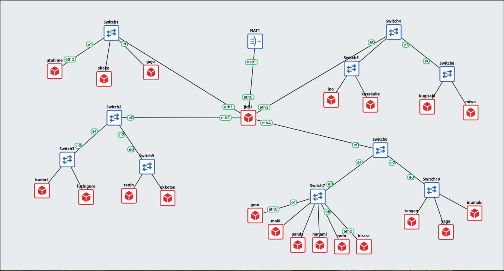
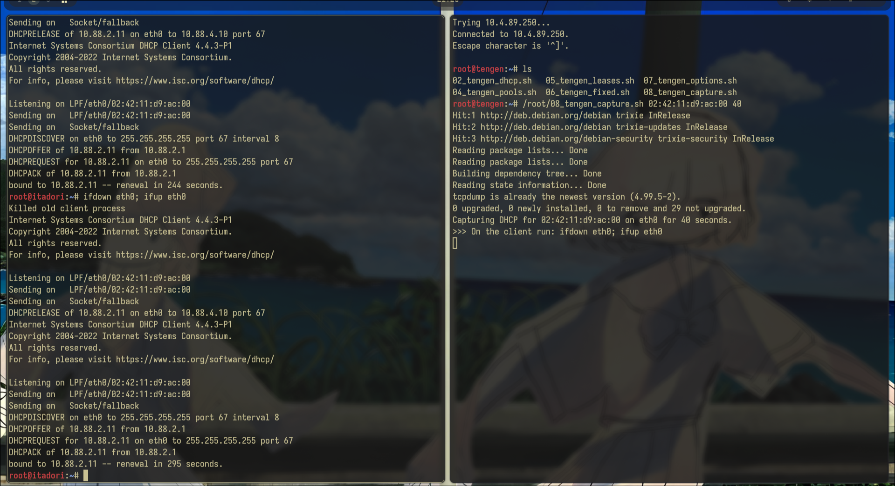
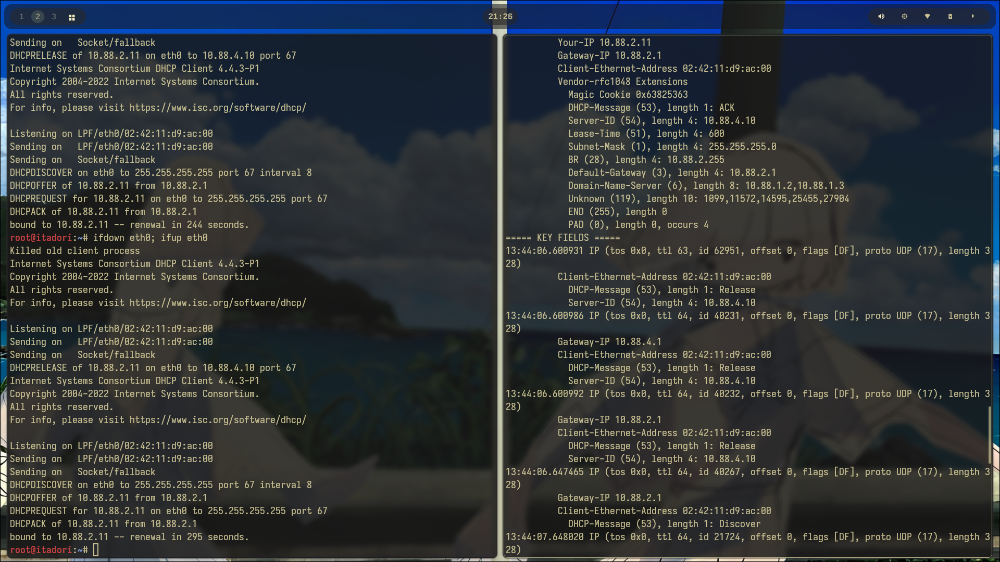
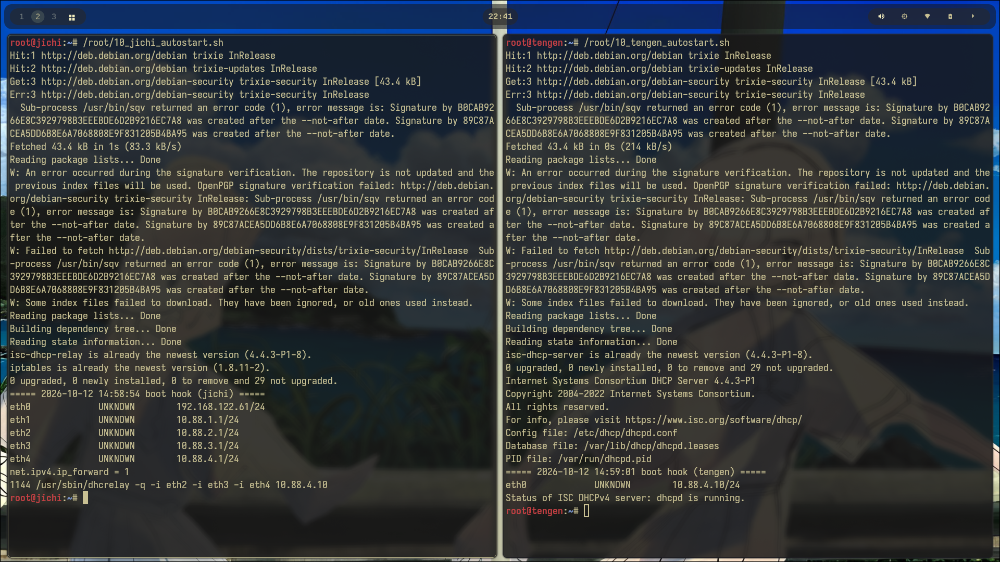

# PRAKTIKUM JARKOM MODUL 3 KELOMPOK K-49 - 2026

## Anggota Kelompok

| Nama | NRP | Dikerjakan |
| ---- | --- | ---------- |
| Khalifa Suryadinarta | 5027251104 | Soal 1 sampai 11 |
| Aura Syahzanani A | 5027251123 | Soal 12 sampai 20 |
|  |  |  |

## Topologi



`jichi` adalah router di tengah. `eth0` ke NAT, sedangkan `eth1` sampai `eth4` masing-masing ke satu jaringan. Semua node memakai image `ardhptr21/debinet:latest`.

### Pemetaan jaringan

| Jaringan | Interface `jichi` | Subnet | Gateway | Isi |
| -------- | ----------------- | ------ | ------- | --- |
| WAN | `eth0` | `192.168.122.0/24` | `192.168.122.1` | alamat dari NAT (DHCP) |
| 1 (DMZ) | `eth1` | `10.88.1.0/24` | `10.88.1.1` | `utahime` `.2` dan `shoko` `.3` (statis), `gojo` |
| 2 (Divisi A) | `eth2` | `10.88.2.0/24` | `10.88.2.1` | `itadori`, `fushiguro` (pool 1), `zenin`, `okkotsu` (pool 2) |
| 3 (Divisi B) | `eth3` | `10.88.3.0/24` | `10.88.3.1` | `ino`, `kusakabe` (short lease), `miwa` (long lease), `kugisaki` (fixed `.99`) |
| 4 (Data Center) | `eth4` | `10.88.4.0/24` | `10.88.4.1` | `tengen` `.10` (statis), `geto`, para worker, database |

Prefix IP kelompok kami `10.88`, grup `K-49`, domain `K-49.com`, subnet mask `/24` di semua jaringan.

### Console tiap node

Akses lewat `telnet 10.4.89.250:<port>` (jaringan atau VPN ITS). **Port berubah setiap project GNS3 dibuka ulang**, jadi baca ulang dari Topology Summary di GNS3 (atau dari API) sebelum memakai tabel ini. Port di bawah adalah kondisi pada 13 Oktober 2026.

| Node | Port | Node | Port | Node | Port |
| ---- | ---- | ---- | ---- | ---- | ---- |
| `jichi` | 5224 | `utahime` | 5206 | `geto` | 5211 |
| `tengen` | 5217 | `shoko` | 5188 | `maki` | 5212 |
| `itadori` | 5207 | `gojo` | 5187 | `panda` | 5213 |
| `fushiguro` | 5208 | `ino` | 5220 | `nanami` | 5214 |
| `zenin` | 5209 | `kusakabe` | 5221 | `todo` | 5215 |
| `okkotsu` | 5210 | `miwa` | 5223 | `kirara` | 5216 |
| `yaga` | 5218 | `kugisaki` | 5222 | `inumaki` | 5219 |

### Kebijakan DHCP di `tengen` (kondisi akhir)

| Kelompok | Client | Rentang | Lease (default / max) |
| -------- | ------ | ------- | --------------------- |
| Pool 1 | `itadori`, `fushiguro` | `10.88.2.10` - `10.88.2.35` | 600 s / 3600 s |
| Pool 2 | `zenin`, `okkotsu` | `10.88.2.70` - `10.88.2.95` | 600 s / 3600 s |
| Tidak boleh dipakai |  | `10.88.2.36` - `10.88.2.69` |  |
| Short lease | `ino`, `kusakabe` | `10.88.3.10` - `10.88.3.89` | 1800 s / 1800 s |
| Long lease | `miwa` | `10.88.3.100` - `10.88.3.199` | 43200 s / 43200 s |
| Fixed | `kugisaki` | `10.88.3.99` (di luar semua pool) | berdasarkan MAC `02:42:2e:c0:2b:00` |

Semua client juga menerima: mask `255.255.255.0`, gateway (`10.88.2.1` atau `10.88.3.1`), broadcast (`10.88.2.255` atau `10.88.3.255`), DNS `10.88.1.2` dan `10.88.1.3`, serta domain-search `K-49.com`.

## Status pengerjaan

| Soal | Isi | Node | Status |
| ---- | --- | ---- | ------ |
| [1](#soal-1) | Router, NAT, forwarding | `jichi` | `jichi` terbukti. Ping tiap host ke gateway ditunjukkan saat demo |
| [2](#soal-2) | DHCP server | `tengen` | Selesai |
| [3](#soal-3) | DHCP relay | `jichi`, client | Selesai |
| [4](#soal-4) | Dua pool di Network 2 | `tengen`, client | Selesai |
| [5](#soal-5) | Lease time dan DHCP option | `tengen`, client | Selesai |
| [6](#soal-6) | Fixed address `kugisaki` | `tengen`, `kugisaki` | Selesai |
| [7](#soal-7) | Pengecekan konfigurasi semua client | `tengen`, client | Selesai |
| [8](#soal-8) | Packet capture DHCP | `tengen` | Selesai |
| [9](#soal-9) | Relay mati lalu dipulihkan | `jichi`, `itadori` | Selesai |
| [10](#soal-10) | Bertahan setelah restart | `tengen`, `jichi` | Server terbukti. Pengecekan client ditunjukkan saat demo |
| [11](#soal-11) | DNS master dan slave | `utahime`, `shoko` | Selesai |
| 12 dst. |  |  | Teman satu kelompok |

## Panduan mengecek hasil

### 1. Menaruh script di node

Semua script ditaruh di `/root` pada node yang dikonfigurasi. Dari komputer yang bisa menjangkau host GNS3:

```bash
tools/push-script.sh 01/01_jichi_router.sh 5224    # salin ke /root/01_jichi_router.sh lalu cocokkan checksum
```

Atau tempel langsung di console node:

```bash
cat > /root/01_jichi_router.sh <<'EOF'
# isi script
EOF
chmod +x /root/01_jichi_router.sh
```

Setiap script diawali `#!/bin/bash` dan `set -e`, memasang paket yang dibutuhkan lebih dulu (pakai DNS `192.168.122.1`), aman dijalankan dua kali, dan berhenti kalau ada langkah penting yang gagal. Komentar di dalam script memakai bahasa Inggris.

### 2. Urutan menjalankan

Script server bersifat kumulatif: `04`, `05`, `06`, dan `07` masing-masing menulis ulang seluruh `dhcpd.conf`, jadi konfigurasi akhir ada di `07_tengen_options.sh`. Kalau mau membangun dari awal, jalankan berurutan seperti ini (script client dijalankan di client yang namanya tertulis di file):

| Langkah | Node | Script | Hasil yang diharapkan |
| ------- | ---- | ------ | --------------------- |
| 1 | `jichi` | `01/01_jichi_router.sh` | `eth0` dari NAT, `eth1`-`eth4` = `10.88.N.1/24`, forwarding aktif, aturan NAT |
| 2 | `tengen` | `02/02_tengen_dhcp.sh` | `10.88.4.10/24`, `dhcpd` berjalan |
| 3 | `jichi` | `03/03_jichi_relay.sh` | `dhcrelay` berjalan menuju `10.88.4.10` |
| 4 | `tengen` | `04/04_tengen_pools.sh` | pool dan class MAC untuk Network 2 |
| 5 | `itadori`, `fushiguro`, `zenin` | `04/04_<node>_dhcp.sh` | client DHCP siap, dapat alamat dari pool-nya |
| 6 | `okkotsu` | `03/03_okkotsu_dhcp.sh`, lalu `04/04_okkotsu_renew.sh` | alamat dari pool 2 |
| 7 | `tengen` | `05/05_tengen_leases.sh` | pool short dan long lease, option DNS |
| 8 | `ino`, `kusakabe` | `05/05_<node>_dhcp.sh` | short lease |
| 9 | `miwa` | `03/03_miwa_dhcp.sh`, lalu `05/05_miwa_renew.sh` | long lease |
| 10 | `tengen` | `06/06_tengen_fixed.sh` | menambah reservasi `kugisaki` |
| 11 | `kugisaki` | `06/06_kugisaki_dhcp.sh` | dapat `10.88.3.99` |
| 12 | `tengen` | `07/07_tengen_options.sh` | menambah option mask dan broadcast (konfigurasi akhir) |
| 13 | `tengen`, `jichi` | `10/10_tengen_autostart.sh`, `10/10_jichi_autostart.sh` | boot hook `/root/init.sh` |
| 14 | `utahime` | `11/11_utahime_dns.sh` | master zona `jujutsu.K-49.com` |
| 15 | `shoko` | `11/11_shoko_dns.sh` | slave, zona tersalin |
| 16 | `utahime`, `shoko` | `11/11_utahime_autostart.sh`, `11/11_shoko_autostart.sh` | boot hook yang menjalankan `named` setelah restart |

Soal 8 dan 9 adalah pengujian, bukan konfigurasi. Scriptnya hanya dijalankan saat pembuktian.

### 3. Cek cepat semua soal

```bash
# jichi
ip -4 a; ip route; cat /proc/sys/net/ipv4/ip_forward; iptables -t nat -L POSTROUTING -n
pgrep -a dhcrelay                       # pakai ini, bukan "service ... status" (lihat catatan)
# tengen
service isc-dhcp-server status; dhcpd -t -cf /etc/dhcp/dhcpd.conf
grep -E "^lease|binding state|hardware|client-hostname" /var/lib/dhcp/dhcpd.leases
# client mana saja
ip -4 a show eth0; ip route; cat /etc/resolv.conf
# DNS, dari client
dig @10.88.1.2 jujutsu.K-49.com SOA +short; dig @10.88.1.3 jujutsu.K-49.com SOA +short
```

### 4. Kalau ada yang tidak jalan

Periksa berurutan dari lapisan paling bawah: interface, IP dan subnet, gateway dan routing, status service dan tes konfigurasi, relay dan `net.ipv4.ip_forward`, client, lalu DNS. Ubah satu hal dalam satu waktu.

### 5. Catatan

- **Tidak ada systemd.** Image `debinet` memakai `dumb-init` sebagai PID 1, jadi `systemctl enable` yang ada di modul tidak bisa dipakai. Service dijalankan dengan `service <nama> ...` dan dinyalakan saat boot lewat `/root/init.sh` (lihat [soal 10](#soal-10)).
- **`service isc-dhcp-relay status` bisa menipu.** Script init relay hanya mengecek ada tidaknya file pid, jadi setelah restart bisa tertulis "running" padahal prosesnya tidak ada. Script dan boot hook kami mengecek proses langsung dengan `pgrep -x dhcrelay`.
- **Menutup lalu membuka ulang project GNS3 membuat container baru.** Sudah kami coba: yang bertahan hanya `/root` (script dan `boot.log`) dan `/etc/network` (alamat dan pin MAC). Paket dan semua file di `/etc` (misalnya `dhcpd.conf` dan zona BIND) hilang, dan client kehilangan `ifup` dan `dhclient`. Jadi setelah project dibuka ulang, jalankan lagi script sesuai urutan di atas. Stop lalu start node biasa tidak menghapus apa-apa, dan boot hook akan menjalankan service-nya sendiri.
- **Port console berubah** setiap project dibuka ulang (lihat tabel di atas). Salah port berarti script masuk ke node yang salah, jadi cek nama dengan `hostname` sebelum menjalankan sesuatu.
- **Client memakai `debinet`**, bukan `alpinet`, sehingga DHCP di client memakai `ifup` dan `dhclient`, bukan `udhcpc`.
- **Peringatan `Not live until ...` dari `apt`** muncul di `jichi` dan `tengen` karena jam node tertinggal beberapa menit. Tidak berpengaruh ke hasil.
- Istilah yang dipakai dijelaskan di [`GLOSSARY.md`](GLOSSARY.md). Modul acuan: <https://github.com/lab-kcks/modul-komdat-jarkom-2026> (`Modul 3/Implementasi`, `Modul 3/DHCP`, `Modul 2/DNS`).

---

# Laporan

## Soal 1

**Penyampaian ulang:** `jichi` dijadikan router. `eth0` mengambil WAN dari NAT, `eth1` sampai `eth4` menjadi gateway Network 1 sampai 4, IPv4 forwarding dan source NAT diaktifkan, host infrastruktur diberi IP statis, lalu konektivitas host ke gateway dan ke luar harus dibuktikan.

### Maksud soal

Semua jaringan dihubungkan lewat satu router dan diberi jalan keluar ke internet. Tanpa ini node lain tidak bisa saling bicara dan tidak bisa mengunduh paket untuk soal berikutnya.

### Cara mengerjakan

1. `eth0` diatur `dhcp`, sedangkan `eth1`-`eth4` diatur statis `10.88.1.1` sampai `10.88.4.1` /24 di `/etc/network/interfaces`.
2. `net.ipv4.ip_forward=1` dinyalakan dan disimpan di `/etc/sysctl.d/99-forward.conf`.
3. Aturan `iptables -t nat ... -o eth0 -j MASQUERADE` ditaruh sebagai `post-up` di `eth0`, supaya ikut aktif setiap interface naik.
4. Node belum punya DHCP client, jadi script memberi `eth0` alamat sementara dulu, memasang `ifupdown` dan `isc-dhcp-client`, lalu pindah ke DHCP.
5. IP statis host lain diatur di script masing-masing: `tengen` `10.88.4.10` (soal 2), `utahime` `10.88.1.2` dan `shoko` `10.88.1.3` (soal 11).

Script:

- [`01_jichi_router.sh`](01/01_jichi_router.sh)

### Cara melakukan validasi

```bash
ip -4 a                                  # eth0 192.168.122.x dynamic; eth1-eth4 = 10.88.N.1/24
ip route                                 # default via 192.168.122.1 dan empat jaringan terhubung
cat /proc/sys/net/ipv4/ip_forward        # 1
iptables -t nat -L POSTROUTING -n        # ada MASQUERADE
ping -c 2 8.8.8.8
```

`jichi`: ping 8.8.8.8, `ip -4 a`, aturan MASQUERADE, dan `ip_forward` bernilai 1


> Ping client ke gateway dan ke `8.8.8.8` juga terlihat di hasil soal 3 sampai 9 (misalnya `okkotsu` dan `miwa`). Tangkapan layar ping untuk host lain ditunjukkan saat demo.

---

## Soal 2

**Penyampaian ulang:** `tengen` dipasangi `isc-dhcp-server` di `10.88.4.10`. Network 4 dideklarasikan sebagai subnet lokal tanpa pool dinamis, scope disiapkan untuk Network 2 dan 3, dan service harus aktif tanpa error "No subnet declaration".

### Maksud soal

DHCP server harus punya setidaknya satu subnet yang cocok dengan interface-nya, kalau tidak `dhcpd` menolak jalan. Network 4 adalah jaringan `tengen` sendiri, jadi dideklarasikan kosong (tanpa `range`) supaya server hidup tapi tidak membagikan alamat di situ. Network 2 dan 3 disiapkan scope-nya untuk client yang datang lewat relay.

### Cara mengerjakan

1. `tengen` diberi `10.88.4.10/24` dengan gateway `10.88.4.1`.
2. `isc-dhcp-server` dipasang, dan `/etc/default/isc-dhcp-server` diisi `INTERFACESv4="eth0"`.
3. `dhcpd.conf` berisi tiga blok `subnet`: Network 4 kosong, Network 2 dan Network 3 dengan `range` dan `option routers`.
4. `dhcpd -t` dijalankan dulu. Kalau lolos, service di-restart.

Script:

- [`02_tengen_dhcp.sh`](02/02_tengen_dhcp.sh)

### Cara melakukan validasi

```bash
ip -4 a show eth0                     # 10.88.4.10/24
ping -c 2 10.88.4.1
dhcpd -t -cf /etc/dhcp/dhcpd.conf     # hanya banner, tanpa error
service isc-dhcp-server status        # dhcpd is running.
cat /etc/dhcp/dhcpd.conf              # tiga subnet, blok Network 4 tanpa range
```

`tengen`: status service, `dhcpd -t`, isi `dhcpd.conf`, dan ping ke gateway


---

## Soal 3

**Penyampaian ulang:** `jichi` dijadikan DHCP relay menuju `tengen` (`10.88.4.10`) lewat `eth2` untuk Network 2 dan `eth3` untuk Network 3, lalu dibuktikan bahwa client dari kedua subnet mendapat lease lewat relay.

### Maksud soal

Permintaan DHCP berupa broadcast, dan router tidak meneruskan broadcast. Client di Network 2 dan 3 tidak akan pernah menjangkau `tengen` di Network 4. Relay di `jichi` mendengar broadcast itu, lalu mengirimkannya ke `tengen` sebagai paket unicast.

### Cara mengerjakan

1. `isc-dhcp-relay` dipasang di `jichi`.
2. `/etc/default/isc-dhcp-relay` diisi `SERVERS="10.88.4.10"` dan `INTERFACES="eth2 eth3 eth4"`. Seperti di modul, interface yang menghadap server (`eth4`) ikut dimasukkan.
3. Service di-restart. IP forwarding dicek tetap `1`.
4. Dua client uji diatur `iface eth0 inet dhcp`: `okkotsu` (Network 2) dan `miwa` (Network 3).

Script:

- [`03_jichi_relay.sh`](03/03_jichi_relay.sh)
- [`03_miwa_dhcp.sh`](03/03_miwa_dhcp.sh)
- [`03_okkotsu_dhcp.sh`](03/03_okkotsu_dhcp.sh)

### Cara melakukan validasi

```bash
# jichi
pgrep -a dhcrelay                    # dhcrelay -q -i eth2 -i eth3 -i eth4 10.88.4.10
cat /etc/default/isc-dhcp-relay
# client
ip -4 a show eth0; ip route          # 10.88.2.x atau 10.88.3.x, default via .1 yang sesuai
# tengen
grep -E "^lease|hardware|client-hostname" /var/lib/dhcp/dhcpd.leases
```

`jichi`: status relay dan isi `/etc/default/isc-dhcp-relay`


`okkotsu` (Network 2) mendapat 10.88.2.10 (dynamic)


`miwa` (Network 3) mendapat 10.88.3.10 (dynamic)


`tengen`: `dhcpd.leases` berisi kedua lease


---

## Soal 4

**Penyampaian ulang:** Network 2 dibagi menjadi dua pool: pool 1 `10.88.2.10`-`.35` untuk `itadori` dan `fushiguro`, pool 2 `10.88.2.70`-`.95` untuk `zenin` dan `okkotsu`. Rentang `10.88.2.36`-`.69` tidak boleh dialokasikan. Karena semua client satu subnet, pemisahnya memakai DHCP class berdasarkan MAC address.

### Maksud soal

Rentang alamat tidak bisa membedakan siapa meminta, karena semua client ada di subnet yang sama. Yang dipakai untuk membedakan adalah MAC address: setiap client dimasukkan ke sebuah class, lalu setiap pool hanya boleh dipakai oleh satu class.

### Cara mengerjakan

1. Ambil MAC tiap client dengan `cat /sys/class/net/eth0/address`.
2. Di `dhcpd.conf` dibuat `class "pool1"` dan `class "pool2"` dengan `match hardware;`, lalu tiap MAC didaftarkan lewat `subclass`.
3. Di `subnet 10.88.2.0` dibuat dua blok `pool`, masing-masing `allow members of "pool1"` atau `"pool2"` dengan `range`-nya sendiri. Karena `.36`-`.69` tidak masuk `range` mana pun, rentang itu tidak pernah dibagikan.
4. Di sisi client, `hwaddress ether <MAC>` ditulis di `/etc/network/interfaces` supaya MAC tetap sama kalau node di-reset GNS3.
5. `okkotsu` sebelumnya sudah dapat `.10` dari soal 3, jadi dia melepas lease lama dan meminta ulang supaya masuk pool 2.

Class dan beberapa pool tidak ada di modul. Bagian ini diambil dari dokumentasi `dhcpd.conf`.

Script:

- [`04_fushiguro_dhcp.sh`](04/04_fushiguro_dhcp.sh)
- [`04_itadori_dhcp.sh`](04/04_itadori_dhcp.sh)
- [`04_okkotsu_renew.sh`](04/04_okkotsu_renew.sh)
- [`04_tengen_pools.sh`](04/04_tengen_pools.sh)
- [`04_zenin_dhcp.sh`](04/04_zenin_dhcp.sh)

### Cara melakukan validasi

```bash
ip -4 a show eth0                     # di tiap client: itadori/fushiguro .10-.35, zenin/okkotsu .70-.95
dhcpd -t -cf /etc/dhcp/dhcpd.conf     # di tengen
grep -E "^lease|hardware|client-hostname" /var/lib/dhcp/dhcpd.leases
```

`itadori`: 10.88.2.11 (pool 1)


`fushiguro`: 10.88.2.12 (pool 1)


`zenin`: 10.88.2.71 (pool 2)


`okkotsu`: 10.88.2.70 (pool 2)


`tengen`: daftar lease (bagian 1)


`tengen`: daftar lease (bagian 2)


`tengen`: `dhcpd.conf` (bagian 1)


`tengen`: `dhcpd.conf` (bagian 2)


`tengen`: `dhcpd -t` dan status service


---

## Soal 5

**Penyampaian ulang:** di Network 3, `ino` dan `kusakabe` mendapat short lease 1800 detik dari pool `10.88.3.10`-`.89`, `miwa` mendapat long lease 43200 detik dari pool `10.88.3.100`-`.199`. `default-lease-time` dan `max-lease-time` disesuaikan per class. Semua client juga menerima DNS `10.88.1.2` dan `10.88.1.3` serta domain-search `K-49.com`.

### Maksud soal

Tiap tim lapangan punya lama kerja yang berbeda, jadi lama pinjam alamatnya juga berbeda. Lease pendek mengembalikan alamat lebih cepat, lease panjang cocok untuk client yang menetap. Option DNS dan domain-search membuat client otomatis tahu ke mana bertanya nama.

### Cara mengerjakan

1. Dibuat class `short-lease` (MAC `ino` dan `kusakabe`) dan `long-lease` (MAC `miwa`).
2. Di `subnet 10.88.3.0` dibuat dua blok `pool`. Lease time ditulis di dalam blok pool itu sendiri: 1800/1800 untuk short, 43200/43200 untuk long.
3. `option domain-name-servers 10.88.1.2, 10.88.1.3;` dan `option domain-search "K-49.com";` ditaruh di bagian atas file, supaya berlaku untuk semua client.
4. Client memakai script yang sama dengan soal 4 (pasang `ifupdown` dan `isc-dhcp-client`, kunci MAC, minta lease). `miwa` sudah punya alatnya, jadi cukup minta lease baru.

Script:

- [`05_ino_dhcp.sh`](05/05_ino_dhcp.sh)
- [`05_kusakabe_dhcp.sh`](05/05_kusakabe_dhcp.sh)
- [`05_miwa_renew.sh`](05/05_miwa_renew.sh)
- [`05_tengen_leases.sh`](05/05_tengen_leases.sh)

### Cara melakukan validasi

```bash
ip -4 a show eth0        # ino/kusakabe: valid_lft sekitar 1800sec; miwa: sekitar 43200sec
cat /etc/resolv.conf     # search K-49.com. / nameserver 10.88.1.2 / nameserver 10.88.1.3
```

`ino`: 10.88.3.11, lease sekitar 1800 detik


`kusakabe`: 10.88.3.12, lease sekitar 1800 detik


`miwa`: proses DHCP lengkap lewat relay, `bound to 10.88.3.100`


`miwa`: 10.88.3.100, lease sekitar 43200 detik


`ino`: `resolv.conf`


`kusakabe`: `resolv.conf`


`miwa`: `resolv.conf`


`tengen`: daftar lease (bagian 1)


`tengen`: daftar lease (bagian 2)


`tengen`: `dhcpd.conf` (bagian 1)


`tengen`: `dhcpd.conf` (bagian 2)


`tengen`: `dhcpd.conf` (bagian 3)


`tengen`: `dhcpd -t` dan status service


---

## Soal 6

**Penyampaian ulang:** `kugisaki` harus selalu mendapat alamat yang sama. Dibuat static lease berdasarkan MAC dengan fixed address `10.88.3.99` yang berada di luar semua pool dinamis, konfigurasi divalidasi, lease di-renew, lalu dibuktikan alamat yang diterima sama dengan reservasi.

### Maksud soal

Client VIP tetap meminta lewat DHCP, tapi server selalu menjawab dengan alamat yang sama karena MAC-nya terdaftar. Alamatnya harus di luar pool supaya tidak pernah diberikan ke client lain.

### Cara mengerjakan

1. MAC `kugisaki` (`02:42:2e:c0:2b:00`) dibaca dari node.
2. Di `dhcpd.conf` ditambahkan blok:

   ```
   host kugisaki {
       hardware ethernet 02:42:2e:c0:2b:00;
       fixed-address 10.88.3.99;
   }
   ```

   `.99` berada di celah antara pool short (`.10`-`.89`) dan pool long (`.100`-`.199`).
3. `dhcpd -t`, lalu restart service.
4. Di `kugisaki`: `ifdown eth0; ifup eth0` untuk renew lease.

Static lease tidak ditulis ke `dhcpd.leases`, jadi buktinya ada di sisi client dan di konfigurasi.

Script:

- [`06_kugisaki_dhcp.sh`](06/06_kugisaki_dhcp.sh)
- [`06_tengen_fixed.sh`](06/06_tengen_fixed.sh)

### Cara melakukan validasi

```bash
# kugisaki
ip -4 a show eth0; ifdown eth0; ifup eth0; ip -4 a show eth0     # 10.88.3.99 sebelum dan sesudah
# tengen
grep -A4 "^host" /etc/dhcp/dhcpd.conf
dhcpd -t -cf /etc/dhcp/dhcpd.conf; service isc-dhcp-server status
```

`kugisaki`: 10.88.3.99 sebelum dan sesudah renew, offer dan ack untuk .99


`tengen`: `dhcpd -t` dan status service


`tengen`: blok `host kugisaki`, `.99` di luar kedua pool


---

## Soal 7

**Penyampaian ulang:** setiap client harus menerima konfigurasi sesuai wilayahnya (mask /24, gateway, broadcast, DNS, domain-search). IP dan routing seluruh client Divisi A dan B diperiksa, lease dicocokkan dengan `dhcpd.leases` di `tengen`, dan tidak boleh ada alamat bentrok atau di luar kebijakan pool.

### Maksud soal

Ini soal pemeriksaan: apakah semua aturan dari soal 2 sampai 6 benar-benar sampai ke client, dan apakah catatan server sama dengan kenyataan di client.

### Cara mengerjakan

1. Broadcast tadinya hanya dihitung sendiri oleh client. Supaya benar-benar dikirim server, `option subnet-mask` dan `option broadcast-address` ditambahkan di kedua subnet.
2. Kedelapan client melakukan renew, lalu option diperiksa langsung di file lease client (`/var/lib/dhcp/dhclient.eth0.leases`).
3. Jurnal lease di `tengen` dibaca (catatan terbaru tiap alamat) dan dicocokkan dengan rentang pool.

Hasilnya 7 lease aktif, semuanya di dalam pool masing-masing, tanpa alamat atau MAC ganda. `kugisaki` tidak ada di daftar itu karena static lease.

Script:

- [`07_tengen_options.sh`](07/07_tengen_options.sh)

### Cara melakukan validasi

```bash
# tiap client
ifdown eth0; ifup eth0
grep "broadcast-address" /var/lib/dhcp/dhclient.eth0.leases | tail -n 1
ip -4 a show eth0; ip route; cat /etc/resolv.conf
# tengen
grep -n "broadcast\|subnet-mask" /etc/dhcp/dhcpd.conf
grep -E "^lease|binding state|hardware|client-hostname" /var/lib/dhcp/dhcpd.leases
```

`tengen`: option mask dan broadcast untuk Network 2 dan 3


`itadori`: renew 10.88.2.11, menerima broadcast 10.88.2.255


`fushiguro`: 10.88.2.12, 10.88.2.255


`zenin`: 10.88.2.71, 10.88.2.255


`okkotsu`: 10.88.2.70, 10.88.2.255


`ino`: 10.88.3.11, 10.88.3.255


`kusakabe`: 10.88.3.12, 10.88.3.255


`miwa`: 10.88.3.100, 10.88.3.255


`kugisaki`: 10.88.3.99, 10.88.3.255


`itadori`: `ip route` (default via 10.88.2.1)


`kugisaki`: `ip route` (default via 10.88.3.1)


`tengen`: jurnal lease (bagian 1)


`tengen`: jurnal lease (bagian 2)


`tengen`: jurnal lease (bagian 3)


`tengen`: `dhcpd -t` dan status service setelah perubahan


Alamat dan broadcast tiap client juga terlihat di tangkapan layar `ip -4 a show eth0` pada soal 4, 5, dan 6.

---

## Soal 8

**Penyampaian ulang:** dibuktikan dengan `tcpdump` di `tengen` bahwa pemberian alamat berjalan sesuai protokol: DHCPDISCOVER, DHCPOFFER, DHCPREQUEST, DHCPACK. Harus terlihat alamat server, alamat yang diberikan, lease time, dan field `giaddr`, dan nilai `giaddr` harus sama dengan interface `jichi` yang menerima request dari subnet client.

### Maksud soal

Sampai soal 7 kita hanya melihat hasil akhirnya (client dapat IP). Di sini yang dilihat adalah prosesnya: empat pesan DHCP berurutan, dan field `giaddr` yang diisi relay dengan alamat interface tempat request masuk. Dengan `giaddr` itulah `tengen` tahu harus memakai scope Network 2 atau Network 3, dan ke mana jawabannya dikirim.

### Cara mengerjakan

1. `08_tengen_capture.sh <MAC-client> <detik>` menjalankan `tcpdump` di `eth0` `tengen`. Filternya membaca MAC client yang ada di dalam paket DHCP (field `chaddr`), yang tidak diubah oleh relay, sehingga hanya paket satu client yang tertangkap.
2. Hasil disimpan ke file `.pcap`, lalu ditampilkan penuh (`-vvv`) dan sebagai ringkasan satu baris per paket.
3. Selama capture berjalan, client meminta lease baru (`08_itadori_renew.sh` atau `08_ino_renew.sh`).
4. Capture dilakukan untuk `itadori` (Network 2) dan `ino` (Network 3).

Script:

- [`08_ino_renew.sh`](08/08_ino_renew.sh)
- [`08_itadori_renew.sh`](08/08_itadori_renew.sh)
- [`08_tengen_capture.sh`](08/08_tengen_capture.sh)

### Cara melakukan validasi

```bash
# tengen: jalankan capture lebih dulu
/root/08_tengen_capture.sh 02:42:11:d9:ac:00 40      # itadori (Network 2); MAC ino: f2:dd:ec:51:c9:cb
# dalam 40 detik, di client
/root/08_itadori_renew.sh
# capture yang tersimpan bisa dibaca lagi
/root/08_tengen_capture.sh 02:42:11:d9:ac:00 0
```

Hasil:

| Jaringan | Client | Server | Alamat diberikan (`yiaddr`) | Lease | `giaddr` | Interface `jichi` |
| -------- | ------ | ------ | --------------------------- | ----- | -------- | ----------------- |
| 2 | `itadori` | `10.88.4.10` | `10.88.2.11` | 600 s | `10.88.2.1` | `eth2` |
| 3 | `ino` | `10.88.4.10` | `10.88.3.11` | 1800 s | `10.88.3.1` | `eth3` |

Keempat pesan dalam satu proses memakai transaction id (`xid`) yang sama. Offer dan ACK dikirim ke alamat `giaddr`, itulah cara jawaban kembali ke relay. Paket `Release` sebelum tiap proses berasal dari `ifdown` dan bukan bagian dari empat langkah itu.

Network 2 (`itadori`): ringkasan per paket, `giaddr` 10.88.2.1


Network 3 (`ino`): decode lengkap ACK dan ringkasan, `giaddr` 10.88.3.1


Network 2: capture dimulai, client meminta lease (pendukung)



Network 2: decode lengkap ACK (pendukung)



---

## Soal 9

**Penyampaian ulang:** service DHCP relay di `jichi` dihentikan, satu client dipaksa meminta lease baru dan gejalanya dicatat. Setelah relay dipulihkan, permintaan diulang dan harus terbukti client kembali mendapat alamat dari pool yang benar dengan gateway semula.

### Maksud soal

Menirukan gangguan jalur relay: apa yang terlihat dari sisi client dan dari sisi data center, dan memastikan pemulihannya benar.

### Cara mengerjakan

1. `09_jichi_relay.sh stop` mematikan relay dan memastikan prosesnya benar-benar hilang. `start` menjalankannya lagi dengan konfigurasi dari soal 3.
2. `09_itadori_renew.sh outage` melepas lease, menghapus alamat, lalu meminta lagi. Semua keluaran disimpan di `/root/09_itadori_outage.log`. Mode `restore` melakukan hal yang sama setelah relay hidup, log di `/root/09_itadori_restore.log`.
3. Selama gangguan, capture dijalankan di `tengen` (skrip soal 8).

Gejala saat relay mati: `DHCPRELEASE`, enam kali `DHCPDISCOVER` dengan jeda makin lama, lalu `No DHCPOFFERS received`. Alamat dan default route di client hilang. Capture di `tengen` tidak melihat Discover maupun Offer sama sekali. Yang sampai hanya satu paket renew dan paket Release dari client, karena paket unicast tetap dirouting biasa, sedangkan Discover (broadcast) bergantung pada relay.

Setelah relay hidup: `DHCPOFFER ... from 10.88.2.1`, `bound to 10.88.2.11` (pool 1), `default via 10.88.2.1`, sama seperti sebelum gangguan.

Script:

- [`09_itadori_renew.sh`](09/09_itadori_renew.sh)
- [`09_jichi_relay.sh`](09/09_jichi_relay.sh)

### Cara melakukan validasi

Tiga console dibuka: `jichi`, `tengen`, `itadori`.

```bash
ip -4 a show eth0; ip route                        # itadori: kondisi awal
/root/09_jichi_relay.sh stop                       # jichi
/root/08_tengen_capture.sh 02:42:11:d9:ac:00 90    # tengen
/root/09_itadori_renew.sh outage                   # itadori: tidak ada offer, tidak ada alamat dan route
/root/09_jichi_relay.sh start                      # jichi
/root/09_itadori_renew.sh restore                  # itadori: DORA lagi, alamat pool 1, default via 10.88.2.1
```

relay `jichi` dihentikan, kondisi awal `itadori`, lalu gejala gangguan


log gejala di `itadori` dan capture `tengen`: tidak ada Discover atau Offer yang sampai


relay dijalankan lagi, `itadori` mendapat DORA, 10.88.2.11, default via 10.88.2.1


---

## Soal 10

**Penyampaian ulang:** DHCP server di `tengen` dan DHCP relay di `jichi` harus menyala sendiri setelah node di-restart. Status layanan, IP, gateway, lease, dan konektivitas client Network 2 dan 3 diverifikasi, dan kebijakan pool 1, pool 2, short lease, long lease, dan fixed address harus tetap berlaku.

### Maksud soal

Konfigurasi yang benar tidak berguna kalau hilang saat node mati lalu hidup lagi. Proses `dhcpd` dan `dhcrelay` tidak ikut hidup sendiri, jadi harus ada mekanisme yang menjalankannya saat boot.

### Cara mengerjakan

Image `debinet` tidak memakai systemd, jadi `systemctl enable` dari modul tidak bisa dipakai. Setelah diperiksa, image menjalankan `/etc/debinet-init.sh` setiap node start, dan script itu menjalankan `/root/init.sh` kalau ada. `/root` adalah volume yang disimpan GNS3, sehingga isinya tetap ada. Karena itu boot hook ditulis di `/root/init.sh`:

- `tengen`: menunggu `eth0` berisi `10.88.4.10`, lalu menjalankan `isc-dhcp-server` kalau belum berjalan.
- `jichi`: menunggu `eth2`-`eth4`, menyalakan lagi `net.ipv4.ip_forward` (sebelumnya hanya pengaturan runtime), memastikan aturan NAT ada, menghapus file pid relay yang basi, lalu menjalankan relay kalau **prosesnya** belum ada.

Kedua hook menulis ke `/root/boot.log`, jadi setiap boot meninggalkan satu bagian bertanda waktu.

Temuan saat pengujian: setelah restart pertama `jichi`, relay ternyata tidak berjalan padahal `service isc-dhcp-relay status` mengembalikan 0. Script init relay hanya mengecek keberadaan file pid, dan file pid lama ikut tersimpan setelah restart. Hook diubah supaya mengecek proses dengan `pgrep -x dhcrelay` dan menghapus file pid yang basi. Restart kedua (di bawah) membuktikan perbaikannya.

Script:

- [`10_jichi_autostart.sh`](10/10_jichi_autostart.sh)
- [`10_tengen_autostart.sh`](10/10_tengen_autostart.sh)

### Cara melakukan validasi

Restart node dari GNS3, tunggu sekitar 30 detik, lalu:

```bash
# tengen
cat /root/boot.log; service isc-dhcp-server status; ip -4 a show eth0; ip route
dhcpd -t -cf /etc/dhcp/dhcpd.conf
# jichi
cat /root/boot.log; pgrep -a dhcrelay; cat /proc/sys/net/ipv4/ip_forward
ip -4 a; ip route; iptables -t nat -L POSTROUTING -n
# client: ifdown eth0; ifup eth0; lalu ip -4 a show eth0; ip route; ping gateway dan 8.8.8.8
```

Bukti bahwa hook jalan sendiri: di `boot.log` ada bagian `boot hook` baru dengan waktu baru setelah restart.

kedua hook terpasang dan dijalankan sekali



`cat /root/init.sh` di `jichi` dan `tengen`


setelah restart pertama: `boot.log` `tengen`, status, `ip`, `dhcpd -t`


setelah restart pertama: interface dan route `jichi` (relay belum jalan)


setelah restart pertama: aturan NAT `jichi`


restart kedua `jichi`: `boot.log`, bagian hook baru menjalankan relay


restart kedua `jichi`: proses `dhcrelay`, `ip_forward`, `ip -4 a`


restart kedua `jichi`: route dan MASQUERADE


> Pengecekan client setelah restart (semua pool, kedua lease time, dan fixed address) ditunjukkan saat demo. Perintahnya sama dengan soal 7, dan hasil client sebelum restart ada di [soal 7](#soal-7).

---

## Soal 11

**Penyampaian ulang:** `utahime` menjadi DNS master dan `shoko` DNS slave untuk zona `jujutsu.K-49.com`, dengan record SOA, NS untuk kedua server, dan `allow-transfer` dari master ke slave. Zona harus tersalin otomatis ke `shoko` saat serial di `utahime` dinaikkan, dibuktikan dengan `dig` ke kedua server dari satu client.

### Maksud soal

Dua server DNS menyimpan zona yang sama supaya pencarian nama tetap jalan kalau satu server mati. Master adalah tempat zona diubah, slave hanya menyalin. Slave tahu zona berubah dari nomor serial di SOA, dan master memberi tahu slave lewat NOTIFY.

### Cara mengerjakan (modul `Modul 2/DNS`, bagian 2.6)

1. `utahime` diberi `10.88.1.2/24` dan `shoko` diberi `10.88.1.3/24`, gateway `10.88.1.1`, lalu BIND9 dipasang di keduanya.
2. Di `utahime`, zona dideklarasikan sebagai master:

   ```
   zone "jujutsu.K-49.com" {
       type master;
       file "/etc/bind/jujutsu/jujutsu.K-49.com";
       notify yes;
       also-notify { 10.88.1.3; };
       allow-transfer { 10.88.1.3; };
   };
   ```

   File zona berisi SOA (primary `utahime.jujutsu.K-49.com.`, serial `2026101201`), NS untuk `utahime` dan `shoko`, serta A record keduanya. `named-checkconf` dan `named-checkzone` dijalankan sebelum restart.
3. Di `shoko`, zona dideklarasikan sebagai slave dengan `masters { 10.88.1.2; };`. Salinan disimpan sebagai teks di `/var/cache/bind` (folder yang boleh ditulis `named`; modul memakai `/etc/bind`).
4. Untuk menguji, record `tengen` ditambahkan di `utahime` dan serial dinaikkan menjadi `2026101202` lalu zona di-reload. `utahime` mengirim NOTIFY dan `shoko` menarik zona baru sendiri.
5. `11_itadori_dns.sh` bertanya ke kedua server dari client, dan juga mencoba zone transfer dari client, yang harus ditolak.
6. Supaya `named` hidup lagi setelah node di-restart, `11_utahime_autostart.sh` dan `11_shoko_autostart.sh` menulis boot hook `/root/init.sh` dengan cara yang sama seperti soal 10: menunggu `eth0` punya alamat, menghapus file pid yang basi, lalu menjalankan `named` kalau prosesnya belum ada. Hasilnya dicatat di `/root/boot.log`. Setelah stop lalu start `utahime` dan `shoko`, bagian `boot hook` baru muncul dan `named` berjalan tanpa perintah manual.

Script:

- [`11_itadori_dns.sh`](11/11_itadori_dns.sh)
- [`11_shoko_autostart.sh`](11/11_shoko_autostart.sh)
- [`11_shoko_dns.sh`](11/11_shoko_dns.sh)
- [`11_utahime_autostart.sh`](11/11_utahime_autostart.sh)
- [`11_utahime_dns.sh`](11/11_utahime_dns.sh)

### Cara melakukan validasi

```bash
/root/11_utahime_dns.sh                           # utahime: setup (cek zona, restart named, dig)
/root/11_shoko_dns.sh                             # shoko: setup, menunggu transfer pertama
/root/11_itadori_dns.sh tengen.jujutsu.K-49.com   # client, sebelum: NXDOMAIN untuk tengen di kedua server
/root/11_utahime_dns.sh serial                    # utahime: tambah tengen -> 10.88.4.10, serial 2026101201 -> 2026101202
/root/11_itadori_dns.sh tengen.jujutsu.K-49.com   # client, sesudah: kedua server serial 2026101202 dan 10.88.4.10
# setelah stop lalu start node utahime dan shoko dari GNS3:
cat /root/boot.log; pgrep -a named; dig @127.0.0.1 jujutsu.K-49.com SOA +short
```

Hasil:

| | Sebelum (serial `2026101201`) | Sesudah (serial `2026101202`) |
| --- | --- | --- |
| `@10.88.1.2` `utahime` | `NXDOMAIN` untuk `tengen` | `NOERROR`, `tengen` = `10.88.4.10` |
| `@10.88.1.3` `shoko` | `NXDOMAIN` untuk `tengen` | `NOERROR`, `tengen` = `10.88.4.10` |

`shoko` tidak disentuh di antara dua pengujian itu. Zone transfer yang diminta dari client berakhir `Transfer failed.`, jadi `allow-transfer` memang hanya mengizinkan `shoko`.

Keluaran pengujian "sesudah" di `itadori` (teks terminal):

```text
===== @10.88.1.2 =====
--- SOA of jujutsu.K-49.com
;; flags: qr aa; QUERY: 1, ANSWER: 1, AUTHORITY: 2, ADDITIONAL: 3
jujutsu.K-49.com.  604800  IN  SOA  utahime.jujutsu.K-49.com. root.jujutsu.K-49.com. 2026101202 604800 86400 2419200 604800
--- A of tengen.jujutsu.K-49.com
;; ->>HEADER<<- opcode: QUERY, status: NOERROR
tengen.jujutsu.K-49.com. 604800  IN  A  10.88.4.10
===== @10.88.1.3 =====
--- SOA of jujutsu.K-49.com
;; flags: qr aa; QUERY: 1, ANSWER: 1, AUTHORITY: 2, ADDITIONAL: 3
jujutsu.K-49.com.  604800  IN  SOA  utahime.jujutsu.K-49.com. root.jujutsu.K-49.com. 2026101202 604800 86400 2419200 604800
--- A of tengen.jujutsu.K-49.com
;; ->>HEADER<<- opcode: QUERY, status: NOERROR
tengen.jujutsu.K-49.com. 604800  IN  A  10.88.4.10
===== zone transfer requested from this client (must be refused) =====
; Transfer failed.
```

`utahime`: cek zona OK (serial 2026101201), `named` berjalan, SOA


`shoko`: zona tersalin dari `utahime`, SOA serial 2026101201


`shoko`: salinan zona dalam bentuk teks


`itadori`: kedua server menjawab, zone transfer dari client ditolak


`itadori`, sebelum: kedua server serial 2026101201 dan NXDOMAIN untuk `tengen` (bagian 1)


`itadori`, sebelum: bagian 2


`utahime`: serial dinaikkan 2026101201 -> 2026101202, zona di-reload


> Tangkapan layar pengujian "sesudah" ditunjukkan saat demo. Hasilnya saat ini baru berupa teks terminal di atas.

---

# Laporan Soal 12 sampai 20

> **Penanda SS:** ✅ sudah ada di PDF · ⚠️ ada tapi sebaiknya diambil ulang · 🆕 belum ada, perlu diambil.
> Path gambar (`NN/proof/...png`) tinggal disesuaikan dengan nama file hasil rename.

| Nama | NRP | Dikerjakan        |
| ---- | --- | ----------------- |
|      |     | Soal 12 sampai 20 |

## IP node

| Node    | IP           | Node     | IP           |
| ------- | ------------ | -------- | ------------ |
| `gojo`  | `10.88.1.10` | `nanami` | `10.88.4.41` |
| `geto`  | `10.88.4.20` | `todo`   | `10.88.4.42` |
| `maki`  | `10.88.4.31` | `kirara` | `10.88.4.43` |
| `panda` | `10.88.4.32` | `yaga`   | `10.88.4.51` |
|         |              | `inumaki` | `10.88.4.52` |

## Alur arsitektur

```
client ──► gojo (10.88.1.10) ──┬─ /     ──► maki, panda        (round robin)
                               └─ /api  ──► geto (10.88.4.20) ─┬─ nanami (w=3)
                                                               ├─ todo   (w=1)
                                                               └─ kirara (backup)
                                           worker API ──► yaga (master DB) ──► inumaki (slave DB)
```

---

## Soal 12

**Ringkasan.** Zona `jujutsu.K-49.com` di `utahime` dilengkapi A record ke `gojo`, CNAME `www`, dan zona reverse `1.88.10.in-addr.arpa`. Forwarder ke `192.168.122.1` dipasang di kedua DNS. `shoko` menyalin kedua zona sebagai slave.

**Langkah**

1. Zona forward: A `jujutsu` ke `10.88.1.10`, CNAME `www` ke `jujutsu.K-49.com.`, serial `2026101401`.
2. Zona reverse `/etc/bind/jujutsu/db.10.88.1` dengan PTR `10` ke `jujutsu.K-49.com.`.
3. `named.conf.options`: `forwarders { 192.168.122.1; };` dan `forward first;`.
4. `shoko`: kedua zona bertipe `slave`, salinan tersimpan di `/var/cache/bind`.

**Validasi**

```
# utahime
named-checkzone jujutsu.K-49.com /etc/bind/jujutsu/jujutsu.K-49.com
named-checkzone 1.88.10.in-addr.arpa /etc/bind/jujutsu/db.10.88.1
pgrep -a -x named; grep -A1 forwarders /etc/bind/named.conf.options
dig @127.0.0.1 jujutsu.K-49.com A +short
dig @127.0.0.1 www.jujutsu.K-49.com CNAME +short
dig @127.0.0.1 -x 10.88.1.10 +short
dig @127.0.0.1 google.com +short | head -n 2

# shoko
ls -l /var/cache/bind
dig @127.0.0.1 jujutsu.K-49.com SOA +short       # serial sama dengan utahime

# client
for s in 10.88.1.2 10.88.1.3; do dig @$s jujutsu.K-49.com SOA +short; dig @$s -x 10.88.1.10 +short; done
ping -c 3 google.com
```

| Bukti                | Hasil di SS                                  |
| -------------------- | -------------------------------------------- |
| Zona forward dan reverse | `OK`, serial `2026101401`                |
| A                    | `10.88.1.10`                                 |
| CNAME                | `jujutsu.K-49.com.`                          |
| PTR                  | `jujutsu.K-49.com.`                          |
| Sinkronisasi slave   | `db.10.88.1` dan `db.jujutsu.K-49.com` ada di `/var/cache/bind`, serial sama |
| Forwarder            | `google.com` ter-resolve (`142.251.175.100`, `.102`) |


 **SS-12.2** `shoko`: zona tersalin, SOA, A, CNAME, PTR, google.com


## Soal 13

**Ringkasan.** `yaga` jadi master MariaDB 11.8 dan `inumaki` jadi slave. Database `db_shibuya_K-49` (tabel `request_logs`) otomatis tereplikasi, dan user `jujutsu` bisa diakses remote dari Network 4.

**Langkah**

1. `yaga`: install MariaDB, aktifkan binary log, buat database, tabel `request_logs` (`id`, `hostname`, `client_ip`, `request_uri`, `created_at`), dan user `jujutsu@10.88.4.%`. Posisi awal binlog: `mysql-bin.000001` / `1679`.
2. `inumaki`: install MariaDB, arahkan ke master `10.88.4.51`, jalankan slave (`13_inumaki_db.sh 10.88.4.51`).
3. Insert baris uji di `yaga`, cek muncul di `inumaki`.
4. Dari `tengen` (Network 4), login sebagai `jujutsu` ke kedua server.

Database dan user di `inumaki` tidak dibuat manual, jadi muncul di sana berarti replikasi jalan.

**Validasi**

```
# yaga
mysql -e "SHOW MASTER STATUS;"
mysql -e "INSERT INTO \`db_shibuya_K-49\`.request_logs (hostname, client_ip, request_uri) VALUES ('uji-replikasi','10.88.2.12','/test');"

# inumaki
mysql -e "SHOW SLAVE STATUS\G" | grep -E "Master_Host|Slave_IO_Running|Slave_SQL_Running|Seconds_Behind|Last_.*Error"
mysql -e "SELECT * FROM \`db_shibuya_K-49\`.request_logs;"

# tengen
mysql -h 10.88.4.51 -u jujutsu -p -e "SHOW DATABASES;"
mysql -h 10.88.4.52 -u jujutsu -p -e "SHOW DATABASES;"
```

Hasil: `Slave_IO_Running: Yes`, `Slave_SQL_Running: Yes`, `Seconds_Behind_Master: 0`, dan `inumaki` berisi dua baris (`uji-replikasi`, `uji-replikasi-2`).

 **SS-13.1** `yaga`: master status, daftar database, tabel `request_logs`
 


>  **SS-13.2** `yaga`: insert `uji-replikasi` dan select


yaga sudah beres, dan screenshot-nya menunjukkan semuanya sesuai:
- IP yaga = 10.88.4.51.
- MariaDB 11.8 terpasang, perintah mysql ada.
- Database db_shibuya_K-49 sudah ada.
- Binary log aktif: mysql-bin.000001, posisi 1974.


> **SS-13.3**  `inumaki`: status slave dan 2 baris tabel (pakai SS yang perintahnya terlihat)


>  **SS-13.4** `tengen`: akses remote `jujutsu` ke kedua database
> 


---

## Soal 14

**Ringkasan.** Web worker (`maki`, `panda`) dan API worker (`nanami`, `todo`, `kirara`) dipasang Nginx + PHP-FPM. Web worker menampilkan nama hostnya, API worker membalas JSON dan menulis log ke `yaga` lewat user `api`. Akses tanpa domain diputus, dan akses langsung ke worker ditolak (`403`).

**Konfigurasi per node**

| Node                      | Root             | `allow`                      | Fungsi                                  |
| ------------------------- | ---------------- | ---------------------------- | --------------------------------------- |
| `panda`                   | `/var/www/html`  | `10.88.1.10`, `127.0.0.1`    | `Web Frontend K-49`, `Dilayani oleh: panda` |
| `maki`                    | `/var/www/web`   | `10.88.1.10`, `127.0.0.1`    | `Dilayani oleh: maki`                   |
| `nanami`, `todo`, `kirara` | `/var/www/api`  | `10.88.4.20`, `127.0.0.1`    | JSON `status`, `worker`, `logged`       |

Selain `allow` di atas semua `deny all`. Tiap worker punya `default_server` dengan `return 444` untuk akses lewat IP. User `api@10.88.4.%` hanya punya `SELECT, INSERT` pada `request_logs`.

**Validasi**

```
# tiap worker
nginx -t
curl -s -H "Host: jujutsu.K-49.com" http://127.0.0.1/ ; echo       # web worker
curl -s -H "Host: jujutsu.K-49.com" http://127.0.0.1/api ; echo    # API worker
curl -s http://127.0.0.1/api                                       # tanpa domain: Empty reply

# yaga
mysql --skip-ssl -e "SELECT user, host FROM mysql.user WHERE user IN ('api','jujutsu');"
mysql --skip-ssl -e "SHOW GRANTS FOR 'api'@'10.88.4.%';"
mysql --skip-ssl -e "SELECT worker, COUNT(*) AS jumlah FROM \`db_shibuya_K-49\`.request_logs GROUP BY worker;"

# itadori
for ip in 10.88.4.31 10.88.4.32 10.88.4.41 10.88.4.42 10.88.4.43; do
  echo -n "$ip -> "; curl -s -o /dev/null -w "%{http_code}\n" -H "Host: jujutsu.K-49.com" http://$ip/
done
```

Hasil: TES 1 `status ok` dan `logged true`, TES 2 log terbaca dari `yaga`, TES 3 `Empty reply from server`. Di `yaga`, `kirara` 1, `nanami` 1, `todo` 2 baris. Dari `itadori`, kelima worker `403`.

> **SS-14.1**  `yaga`: user `api` dan `jujutsu`, grants `SELECT, INSERT`


Hak user api sudah benar. Layar yaga menunjukkan:
- api@10.88.4.% dan jujutsu@10.88.4.% sama-sama ada.
- GRANT SELECT, INSERT ON db_shibuya_K-49.request_logs TO api@10.88.4.%, jadi API bisa menulis log ke tabel itu dan tidak punya hak lain.

> **SS-14.2**  `inumaki`: user `api` dan `jujutsu` ikut tereplikasi, slave tetap `Yes`/`Yes`/`0`


> **SS-14.3**  `panda`: vhost, `nginx -t`, curl
> 


> **SS-14.4**  `maki`: vhost, `nginx -t`, curl


>  **SS-14.5** `nanami`: vhost API, `nginx -t`, JSON


> **SS-14.6**  `nanami`: TES 1 sampai 3


Hasil yang benar
- Tes 1: JSON dengan "status":"ok", "worker":"nanami", "logged":true.
- Tes 2: JSON berisi daftar logs, minimal ada baris dari tes 1.
- Tes 3: Empty reply from server.


> **SS-14.7**  `yaga`: log terakhir berisi baris `nanami`


>  **SS-14.8** `todo`: vhost API dan `nginx -t`


Nginx dan PHP-FPM berjalan di todo sebagai worker API. Virtual host merespons domain jujutsu.K-49.com dan www.jujutsu.K-49.com, endpoint /api menjawab JSON dengan "worker":"todo" dan "logged":true. Akses langsung dibatasi hanya dari geto (10.88.4.20) dan localhost, selain itu deny all. nginx -t sukses.

> **SS-14.9**  `todo`: TES 1 sampai 3


>  **SS-14.10** `kirara`: vhost API dan `nginx -t`


Nginx dan PHP-FPM berjalan di kirara sebagai worker API cadangan. Virtual host merespons domain jujutsu.K-49.com dan www.jujutsu.K-49.com, endpoint /api menjawab JSON dengan "worker":"kirara" dan "logged":true. Akses langsung dibatasi hanya dari geto (10.88.4.20) dan localhost, selain itu deny all. nginx -t sukses. 


>  **SS-14.11**  `kirara`: TES 1 sampai 3


>  **SS-14.12**  `yaga`: `GROUP BY worker`


>  **SS-14.13** `itadori`: akses langsung ke 5 worker `403`, lewat `gojo` berhasil


Client Network 2 (IP 10.88.2.12, gateway 10.88.2.1) mengakses langsung seluruh worker (maki, panda, nanami, todo, kirara) dan semuanya ditolak dengan status 403 Forbidden. Akses melalui reverse proxy gojo berhasil: halaman web dijawab bergantian oleh maki dan panda, sedangkan /api dijawab oleh nanami dan todo melalui geto dengan rasio sekitar 3:1. 


---

## Soal 15

**Ringkasan.** `geto` jadi load balancer API dengan upstream `api_cluster`: `nanami` weight 3, `todo` weight 1, `kirara` `backup`. Uji 40 request dari `maki` menghasilkan 30 `nanami` dan 10 `todo` (3:1).

**Konfigurasi `geto`** (`/etc/nginx/sites-enabled/api-lb`)

```
upstream api_cluster {
    server 10.88.4.41 weight=3 max_fails=2 fail_timeout=5s;   # nanami
    server 10.88.4.42 weight=1 max_fails=2 fail_timeout=5s;   # todo
    server 10.88.4.43 backup;                                  # kirara
}
server {
    listen 80 default_server;
    server_name jujutsu.K-49.com www.jujutsu.K-49.com;
    location /api {
        proxy_pass http://api_cluster;
        proxy_set_header Host $host;
        proxy_set_header X-Real-IP $remote_addr;
        proxy_set_header X-Forwarded-For $proxy_add_x_forwarded_for;
    }
}
```

**Validasi**

```
# geto
nginx -t

# maki
for i in $(seq 1 8);  do curl -s -H 'Host: jujutsu.K-49.com' http://10.88.4.20/api | grep -o '"worker":"[a-z]*"'; done
for i in $(seq 1 40); do curl -s -H 'Host: jujutsu.K-49.com' http://10.88.4.20/api | grep -o '"worker":"[a-z]*"'; done | sort | uniq -c
```

>  **SS-15.1** `geto`: upstream `api_cluster` dan `nginx -t`


Nginx pada geto dikonfigurasi sebagai Load Balancer internal dengan upstream api_cluster yang mengarah ke nanami (weight=3) dan todo (weight=1) menggunakan algoritma Weighted Round Robin. nginx -t berhasil. 


>  **SS-15.2**  `maki`: 8 request pertama dan hitungan 40 request (30 `nanami`, 10 `todo`)


Dari node maki di jaringan lokal Data Center dikirim 40 request ke geto (10.88.4.20/api). Hasilnya nanami menjawab 30 kali dan todo 10 kali, rasio 3:1 sesuai weight pada upstream api_cluster. 

---

## Soal 16

**Ringkasan.** `gojo` meneruskan `/` ke upstream `web_workers` (`maki` dan `panda`, round robin) dan `/api` ke `geto`. Dari `itadori`, `jujutsu.K-49.com` ter-resolve ke `10.88.1.10`.

**Konfigurasi `gojo`** (`/etc/nginx/sites-enabled/web-proxy`)

```
upstream web_workers {
    server 10.88.4.31;   # maki
    server 10.88.4.32;   # panda
}
server {
    listen 80 default_server;
    server_name jujutsu.K-49.com www.jujutsu.K-49.com;
    location /    { proxy_pass http://web_workers; ... }
    location /api { proxy_pass http://10.88.4.20;  ... }   # geto
}
```

**Validasi**

```
# gojo
nginx -t

# itadori
getent hosts jujutsu.K-49.com
for i in $(seq 1 6); do curl -s http://jujutsu.K-49.com/ | grep -o 'Dilayani oleh: [a-z]*'; done
for i in $(seq 1 8); do curl -s http://jujutsu.K-49.com/api | grep -o '"worker":"[a-z]*"'; done
```

Hasil: `/` bergantian `maki` dan `panda`, `/api` dijawab `nanami` dan `todo`.

> **SS-16.1**  `gojo`: konfigurasi dan `nginx -t`


Nginx pada gojo melayani jujutsu.K-49.com dan www.jujutsu.K-49.com dengan Path-Based Routing. Request / diteruskan secara Round Robin ke upstream web_workers (maki 10.88.4.31 dan panda 10.88.4.32), sedangkan request /api diteruskan ke geto (10.88.4.20). nginx -t berhasil. 

>  **SS-16.3** `itadori`: DNS ke `10.88.1.10`, `/` bergantian, `www`, `/api`


 Dari client Divisi A (10.88.2.12), domain jujutsu.K-49.com ter-resolve ke gojo (10.88.1.10). Akses ke / dan www dijawab bergantian oleh maki dan panda (Round Robin), sedangkan akses ke /api diteruskan melalui geto dan dijawab oleh nanami/todo. 


---

## Soal 17

**Ringkasan.** IP asli client diteruskan sampai ke worker dan tercatat di `yaga`, tanpa bisa dipalsukan. Tiap lapisan hanya percaya header dari lapisan tepat di depannya.

| Node                       | Yang dilakukan                                                                                                   |
| -------------------------- | ---------------------------------------------------------------------------------------------------------------- |
| `gojo`                     | Mengirim `X-Real-IP $remote_addr` dan `X-Forwarded-For $proxy_add_x_forwarded_for`. `X-Real-IP` selalu ditimpa dengan IP yang benar-benar terhubung. |
| `geto`                     | `set_real_ip_from 10.88.1.10;` `real_ip_header X-Real-IP;` `real_ip_recursive off;`. Header dari sumber lain diabaikan. Ke worker: `X-Real-IP $remote_addr` dan `X-Forwarded-For "$http_x_forwarded_for, $realip_remote_addr"`. |
| `nanami`, `todo`, `kirara` | `index.php` memakai `trusted_client_ip()`: `X-Real-IP` hanya dipercaya kalau request datang dari `geto` (`10.88.4.20`). `X-Forwarded-For` mentah tidak dipakai lagi. |

`miwa` dipakai sebagai client Network 3 dengan IP manual `10.88.3.200`, hanya untuk pengujian ini.

**Validasi**

```
# gojo, geto
grep -n "X-Real-IP\|X-Forwarded-For" /etc/nginx/sites-enabled/*; nginx -t
grep -rn "real_ip" /etc/nginx/conf.d/

# worker
php -l /var/www/api/index.php
grep -n "trusted_client_ip" /var/www/api/index.php

# itadori dan miwa
for i in 1 2 3 4; do curl -s http://jujutsu.K-49.com/api; echo; done

# uji pemalsuan
curl -s -H 'X-Real-IP: 1.2.3.4' http://jujutsu.K-49.com/api                                   # itadori -> gojo
curl -s -H 'Host: jujutsu.K-49.com' -H 'X-Real-IP: 1.2.3.4' http://10.88.4.20/api             # maki -> geto

# yaga
mysql --skip-ssl -e "SELECT client_ip, COUNT(*) AS jumlah FROM \`db_shibuya_K-49\`.request_logs GROUP BY client_ip;"
```

Hasil: `client` selalu IP asli (`10.88.2.12`, `10.88.3.200`, `10.88.4.31` untuk `maki`), `1.2.3.4` tidak pernah tercatat.

> Baris `10.88.2.12, 10.88.1.10` dan `127.0.0.1, 10.88.1.10` di `yaga` adalah log lama sebelum `trusted_client_ip()` dipasang (15:39). Setelah itu semua baris hanya berisi satu IP.

>  **SS-17.1**  `gojo`: header proxy dan `nginx -t`


Nginx gojo meneruskan IP klien lewat header X-Real-IP (remoteaddr)danX-Forwarded-For(proxy_add_x_forwarded_for) ke worker web dan geto. 

>  **SS-17.2** `geto`: `set_real_ip_from`, `real_ip_header`, header ke worker


geto hanya mempercayai X-Real-IP dari proxy terpercaya gojo (set_real_ip_from 10.88.1.10). Header dari sumber lain diabaikan, sehingga $remote_addr di geto menjadi IP klien asli. X-Forwarded-For diteruskan sebagai rantai IP klien dan IP proxy pengirim. 

>  **SS-17.3**  `nanami`, `todo`, `kirara`: `php -l` ok, `trusted_client_ip()` ada


> `itadori`: `"client":"10.88.2.12"`


> 4 respons JSON dengan "client":"10.88.2.12".
> request ke /api lewat gojo → geto → worker. Respons menunjukkan IP asli client Network 2 (10.88.2.12), bukan IP gojo atau geto. 

> `miwa`: `"client":"10.88.3.200"`


> client miwa (Network 3): request ke /api lewat gojo → geto → worker. Respons menunjukkan IP asli client Network 3 (10.88.3.200), bukan IP gojo atau geto. IP diset manual karena client tidak memiliki klien DHCP, dan hanya untuk pengujian soal ini.

> Uji pemalsuan dari `itadori` (via `gojo`) dan `maki` (langsung ke `geto`)


> uji spoofing: header X-Real-IP palsu dari sumber tidak terpercaya (maki) diabaikan geto. Header palsu dari client lewat gojo juga ditimpa gojo dengan IP asli. Alamat yang tercatat tetap IP asli. 

>  `yaga`: `request_logs` dan rekap `client_ip`


tabel request_logs mencatat client_ip sesuai IP klien asal (Network 2 dan Network 3), bukan IP gojo atau geto. Header palsu (1.2.3.4) tidak pernah tercatat. 

---

## Soal 18

**Ringkasan.** Kalau `nanami` dan `todo` mati, `geto` otomatis memakai `kirara` (`backup`). Server utama ditandai gagal setelah `max_fails=2` dalam `fail_timeout=5s` (passive health check).

**Langkah**

1. Cek konfigurasi dengan `nginx -T`.
2. Cek tiap worker langsung di `/api`: `nanami`, `todo`, `kirara-backup`.
3. `nginx -s stop` di `nanami` dan `todo`.
4. Dari `geto`, minta `/api` lewat proxy, harus `200` dan dijawab `kirara-backup`.
5. Nyalakan lagi `nanami` dan `todo`.

**Validasi**

```
# geto
nginx -T 2>&1 | grep -A5 'upstream api_cluster'
for ip in 10.88.4.41 10.88.4.42 10.88.4.43; do echo "== $ip"; curl -sS --max-time 3 http://$ip/api; echo; done

# nanami dan todo
nginx -s stop

# geto (saat gagal)
for i in 1 2 3; do curl -s --max-time 10 -H 'Host: jujutsu.K-49.com' http://127.0.0.1/api; echo; done

# nanami dan todo
nginx -t && nginx
```

> `geto`: `nginx -T`, upstream berisi `weight=3`, `weight=1`, `backup`


Konfigurasi upstream api_cluster menggunakan Nanami dan Todo sebagai server utama dengan bobot 3:1, serta Kirara sebagai server cadangan (backup). Server utama memakai max_fails=2 dan fail_timeout=5s. 

> Pengujian konektivitas memastikan ketiga worker dapat diakses melalui endpoint /api dan memberikan respons HTTP 200 OK. 


> Permintaan API melalui reverse proxy Geto diteruskan ke upstream sesuai konfigurasi Nginx. Respons berhasil menunjukkan layanan dapat dijangkau melalui proxy.


> `nanami` dan `todo`: `nginx -s stop`
> Pengujian failover dilakukan dengan menghentikan layanan Nginx pada server utama Nanami dan Todo. Setelah kedua server tidak tersedia, permintaan API dikirim melalui Geto. Hasil pengujian menunjukkan respons HTTP 200 OK dengan pesan kirara-backup, yang membuktikan bahwa Nginx berhasil mengalihkan permintaan ke Kirara sebagai server cadangan. Dengan demikian, layanan API tetap dapat diakses meskipun kedua server utama mengalami kegagalan.


---

## Soal 19

**Ringkasan.** `gojo` diberi proxy cache 10 menit untuk `/` dan rate limit 10 request per detik per IP untuk `/api` (zona `api_limit`). Rate limit terbukti: dari 40 request cepat, 14 lolos (`200`) dan 26 ditolak (`429`). Cache belum terbukti di SS yang ada (lihat peringatan).

**Konfigurasi** (di `gojo`)

```
proxy_cache_path /var/cache/nginx/web levels=1:2 keys_zone=web_cache:10m inactive=10m;
limit_req_zone $binary_remote_addr zone=api_limit:10m rate=10r/s;

# location /
proxy_cache web_cache;
proxy_cache_valid 200 10m;
add_header X-Cache-Status $upstream_cache_status;

# location /api
limit_req zone=api_limit burst=10 nodelay;
limit_req_status 429;
```

<!-- Sesuaikan path cache, nama zona cache, dan nilai burst dengan konfigurasi aslinya. Dari error log, nilai excess sekitar 10. -->

**Validasi**

```
nginx -t; service nginx status
grep -rnE "proxy_cache|limit_req|X-Cache-Status" /etc/nginx/nginx.conf /etc/nginx/conf.d /etc/nginx/sites-enabled

# cache
for i in 1 2; do echo "== $i"; curl -s -D - -o /dev/null -H 'Host: jujutsu.K-49.com' http://127.0.0.1/ | grep -Ei 'HTTP/|X-Cache-Status'; done

# rate limit
for i in $(seq 1 40); do curl -s -o /dev/null -w "%{http_code}\n" -H 'Host: jujutsu.K-49.com' http://127.0.0.1/api; done | sort | uniq -c

# log
grep "limiting requests" /var/log/nginx/error.log | tail -n 15
```

> `gojo`: `nginx -t` dan `nginx is running`
> Konfigurasi Nginx pada Gojo berhasil divalidasi dan layanan berjalan. Konfigurasi mencakup reverse proxy frontend, proxy caching dengan masa berlaku 10 menit, serta rate limiting pada endpoint /api sebesar 10 request per detik per IP klien.


> Gojo (proxy caching): Pengujian menunjukkan request pertama ke halaman frontend menghasilkan status cache MISS, sedangkan request berikutnya menghasilkan HIT. 


Hal ini membuktikan bahwa respons yang memenuhi syarat cache disimpan dan dapat digunakan kembali selama masa berlaku cache 10 menit.

> Gojo (rate limiting): Pengujian dilakukan dengan mengirimkan 40 request berturut-turut ke endpoint /api melalui reverse proxy Gojo. Respons HTTP 429 Too Many Requests menunjukkan bahwa request yang melampaui batas yang diizinkan ditolak oleh mekanisme rate limiting.

> `gojo`: 40 request ke `/api`, `14` x `200` dan `26` x `429`


> `gojo`: error log `limiting requests ... zone "api_limit"`


Gojo (analisis log): Access log dan error log Nginx diperiksa untuk mengidentifikasi request yang diteruskan ke layanan backend serta request yang ditolak oleh kebijakan rate limiting. Log digunakan sebagai bukti pendukung hasil pengujian.

---

## Soal 20

**Ringkasan.** `kusakabe` (Network 3) menjalankan Apache Benchmark ke `gojo` untuk `/` dan `/api`, masing-masing 600 request, concurrency 30.

**Validasi**

```
# kusakabe
ab -n 600 -c 30 -H 'Host: jujutsu.K-49.com' http://10.88.1.10/
ab -n 600 -c 30 -H 'Host: jujutsu.K-49.com' http://10.88.1.10/api

# gojo
tail -n 50 /var/log/nginx/access.log
```

**Hasil** (dari output `ab` di SS)

| Parameter           | `/`          | `/api`       |
| ------------------- | ------------ | ------------ |
| Total request       | 600          | 600          |
| Concurrency         | 30           | 30           |
| Waktu uji           | 0,128 s      | 0,130 s      |
| Requests per second | 4670,90      | 4630,74      |
| Waktu per request   | 6,423 ms     | 6,478 ms     |
| Failed requests     | 0            | 597 (Length) |
| Non-2xx             | 600          | 588          |
| Respons 2xx         | 0            | 12           |

**Analisis**

- **`/`**: seluruh 600 respons non-2xx. Access log `gojo` menunjukkan `502`, artinya upstream frontend (`maki`/`panda`) tidak menjawab. Throughput tinggi di sini hanya kecepatan membalas error, bukan kinerja sebenarnya.
- **`/api`**: hanya 12 request sukses, 588 ditolak `429` oleh rate limit. Angka 12 sejalan dengan hasil soal 19 (14 sukses dari 40).
- **`Failed requests` 597** bukan kegagalan koneksi. `ab` menghitungnya gagal karena panjang body beda dari respons pertama (`200` sekitar 32 sampai 34 byte, `429` 162 byte).
- **Kesimpulan**: rate limiting bekerja dan menahan lonjakan request ke API. Benchmark `/` belum valid sampai `502` diperbaiki.


> `kusakabe`: `ab` ke `/`.


Hasil benchmark Apache Benchmark pada endpoint / dengan 600 request dan concurrency 30. 

> `kusakabe`: `ab` ke `/api`


Hasil benchmark endpoint /api untuk mengamati dampak rate limiting terhadap request bersamaan. 


>  `gojo`: access log (`429` dari `ApacheBench` dan `200` dari `curl`)


Access log Gojo menunjukkan request API yang ditolak oleh rate limiting (429), kegagalan upstream frontend (502), dan respons sukses API (200). 

---

## Struktur repository

```text
.
├── README.md              laporan ini
├── GLOSSARY.md            penjelasan istilah
├── topology/              gambar topologi GNS3
├── tools/push-script.sh   menyalin script ke /root node dan mengecek checksum
└── 01 ... 11/             satu folder per soal
    ├── NN_<node>_<kata>.sh    script soal tersebut
    └── proof/                 tangkapan layar soal tersebut
```
